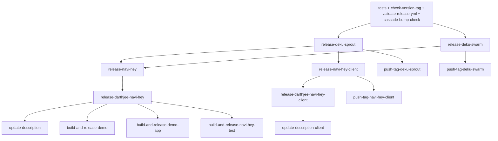

# Release Cycle

How Navi's packages and Docker images are released by CI (`.circleci/config.yml`, workflow `test-and-release`). One `X.Y.Z` tag releases every package whose version is not published yet. The credential used to push the extra tags is covered in [Release Token](release-token.md).

## Tags

- **`X.Y.Z` is the only release trigger.** It is the `navi-hey` version. `check-version-tag` (`scripts/check_tag_version.sh`) fails the release unless the tag matches both `source/package.json` and the `Navi-Hey` row of the Versions table in `README.md`.
- **Branches (PRs and `main`) run tests only.** Every test job uses the same filter (`tags: only: /^\d+\.\d+\.\d+$/`), so tests also run on, and gate, every `X.Y.Z` tag. The release jobs use `branches: ignore: /.*/`, so they run on `X.Y.Z` tags only.
- **Every other tag starts no pipeline**, not even tests.
- **Extra tags are history only.** After a package publishes, CI pushes an extra tag for it:

  | Package | Extra tag |
  |---|---|
  | `deku-sprout` | `sprout-<deku-sprout/package.json version>` |
  | `deku-swarm` | `swarm-<deku-swarm/package.json version>` |
  | `navi-hey-client` | `node_client-<clients/node/package.json version>` |

  `navi-hey` gets no extra tag (its tag is the `X.Y.Z` tag itself), nor do the Docker images. The legacy `worker-X.Y.Z`, `deku-sprout-X.Y.Z` and `client-X.Y.Z` tags stay in the repository as history; nothing creates new ones and CI ignores them.

A release that only touches another package still needs a `navi-hey` bump to get an `X.Y.Z` tag. The cascade-bump test already forces it for `deku-sprout` and `deku-swarm` (`navi-hey` depends on both); a client-only release bumps `navi-hey` only to produce the tag.

## Packages and `release.yml`

| Release | Folder | Platform | Depends on | Extra tag |
|---|---|---|---|---|
| `deku-sprout` | `deku-sprout/` | npm | - | `sprout-` |
| `deku-swarm` | `deku-swarm/` | npm | - | `swarm-` |
| `navi-hey` | `source/` | npm | `deku-sprout`, `deku-swarm` | - |
| `darthjee/navi-hey` | `source/` | Docker Hub | `navi-hey` | - |
| `navi-hey-client` | `clients/node/` | npm | `deku-sprout` | `node_client-` |
| `darthjee/navi-hey-client` | `clients/node/` | Docker Hub | `navi-hey-client` | - |

The root `release.yml` is the single source of this tree: each entry under `packages:` gives `folder`, `platform` (`npm` or `docker`), `depends_on` and, optionally, `tag_prefix`. A Docker entry's version is the `version` of the `package.json` in its folder.

- **Readers.** `scripts/release/` (a small Node package with its own Jasmine specs, CI jobs `jasmine-release` / `checks-release`) parses it. `scripts/release/bin/release-package-info.js` prints one entry as `KEY=value` lines, sourced by the shell scripts through `scripts/lib/release_package_info.sh` (`read_package_info`): `scripts/ci/release-npm-package.sh`, `scripts/ci/push-release-tag.sh` and `scripts/bump_version.sh`.
- **Validator.** `scripts/ci.sh validate-release-yml` (CI job `validate-release-yml`) checks each npm entry's `depends_on` against its `package.json`: every listed dependency must be declared there, and every local package declared there must be listed.
- **CI wiring.** The `requires` lists of the release jobs in `.circleci/config.yml` must mirror `release.yml`'s `depends_on`. Nothing generates them, so a new dependency means editing both.

## Release detection

On an `X.Y.Z` tag, every release job runs; each one releases its package only when the version is not published yet, and no-ops otherwise. Detection is by published version, not by diffing files.

- **npm** (`scripts/ci.sh release-npm <package>` → `scripts/ci/release-npm-package.sh`): `npm view <package>@<version> version`. An empty answer or a 404 means "publish"; any other `npm view` error fails the job. Before deciding, it:
  1. runs the forgotten-bump check (`scripts/lib/package_bump_check.sh`, base `HEAD^`): the job **fails** when `<folder>/lib` or `<folder>/package.json` changed since the package's last release tag (`<tag_prefix>X.Y.Z`, falling back to the last `X.Y.Z`) while the version stayed the same. `SKIP_BUMP_CHECK=true` skips it;
  2. waits (`scripts/ci/wait-for-npm.sh`, every 10 s for up to 5 min) until npm serves the current version of each dependency.

  After an actual publish it waits until npm serves the new version, so dependents and the Docker build never race npm propagation.
- **Docker Hub** (`scripts/ci.sh release-docker <image> <folder> <make target>` → `scripts/ci/release-docker-image.sh`): `scripts/ci/docker-hub-tag-exists.sh` checks `<image>:<version>` through the public Hub API. When missing, it runs `make <target> TAG=<version>` (`release` for `darthjee/navi-hey`, `release-client` for `darthjee/navi-hey-client`), which pushes `:<version>` and `:latest`.
- **Released flag.** Each release job (except `release-navi-hey`, which nothing reads from) writes `true`/`false` into the CircleCI workspace file `released/<name with / replaced by ->` (e.g. `released/darthjee-navi-hey`). Follower jobs read it through the `skip-unless-released` command (`scripts/ci/released.sh`, POSIX `sh` since the `darthjee/scripts` image has no bash): `false` halts the job as a no-op, a missing file or unexpected content fails it.
- `DRY_RUN=1` makes every release script print what it would publish, push or wait for instead of doing it.

`release-navi-hey` additionally builds the frontend (`scripts/ci.sh build-frontend`) and pins its local dependencies (`scripts/ci.sh pin-local-deps`): the `file:../deku-sprout` and `file:../worker` links in `source/package.json` become the exact `deku-sprout/` and `deku-swarm/` versions, and any `file:` dependency left fails the release.

## Cascade-bump test

`scripts/ci.sh cascade-bump-check` (CI job `cascade-bump-check`, implemented in `scripts/release/` as `checkCascadeBumps`, entrypoint `scripts/release/bin/check-cascade-bumps.js`) runs on every branch and on `X.Y.Z` tags, and gates every release job. When a package's version changed, every package depending on it, directly or transitively per `release.yml`, must have changed its version too; otherwise it fails, naming the missing bumps.

- A `deku-sprout` bump requires `navi-hey` and `navi-hey-client` bumps.
- A `deku-swarm` bump requires a `navi-hey` bump.
- A `navi-hey-client` bump requires nothing more.

The comparison base is the previous `X.Y.Z` tag reachable from `HEAD^` on an `X.Y.Z` tag, `HEAD^` on `main`, and `git merge-base HEAD origin/main` on other branches. With no base (e.g. no previous `X.Y.Z` tag), it passes with a message. A package with no `package.json` at the base counts as not bumped. Docker entries are not checked on their own: they follow their folder's version.

## CI flow

- The four npm release jobs require every test and lint job, `check-version-tag`, `validate-release-yml` and `cascade-bump-check`, plus their own dependencies' release jobs. `release-navi-hey-client` does not wait for `release-deku-swarm`.
- A job waits for its dependencies whether they released or no-oped.
- **Extra-tag jobs** (`push-tag-<package>`, `scripts/ci.sh push-tag <package>` → `scripts/ci/push-release-tag.sh`) halt unless their package published, then push the annotated `<tag_prefix><version>` tag on the commit being built with `GITHUB_TOKEN`, skipping a tag that already exists. See [Release Token](release-token.md).
- **Image followers.** `update-description`, `build-and-release-demo`, `build-and-release-demo-app` (Render deploys through `scripts/deploy.sh`) and `build-and-release-navi-hey-test` act only when `darthjee/navi-hey` released; `update-description-client` only when `darthjee/navi-hey-client` released. They halt as no-ops otherwise.
- Every release job is idempotent, so a failed release workflow can simply be re-run.

## Cutting a release

Versions are bumped with `scripts/bump_version.sh [--force] [app|all|client|deku-swarm|deku-sprout] [version]`, never by hand. The target defaults to `app`; an omitted version auto-increments the target's patch version.

- `app` bumps `source/package.json`, the `Navi-Hey` row (Current/Next) of the Versions table and the GitHub Release badges of `README.md` and `source/README.md` and the `FROM darthjee/navi-hey:<v>` line of `dockerfiles/demo_navi_hey/Dockerfile`. It refuses (exit non-zero, nothing changed) while `deku-swarm/` or `deku-sprout/` is stale, i.e. their published files changed since their last release tag but their working-tree version did not; `--force` overrides, and `all` bumps the app plus every stale package, plus `client` when `deku-sprout` changed since the last `X.Y.Z` release while the client did not (the cascade-bump test requires it). Every planned bump is checked first, so a missing README row or badge aborts before any file changes.
- `client`, `deku-swarm` and `deku-sprout` bump their `package.json`, their row of the README Versions table (whose links use the `release.yml` tag prefixes) and their version badges in the package READMEs.

Example: `deku-swarm/` and `source/` changed since `1.15.0`. Run `scripts/bump_version.sh all` (bumps `deku-swarm` and `navi-hey` to `1.15.1`), merge, then tag `1.15.1`. On that tag `release-deku-swarm` publishes and `push-tag-deku-swarm` pushes `swarm-<v>`; `release-deku-sprout` no-ops; `release-navi-hey` publishes `1.15.1`; `release-darthjee-navi-hey` pushes the image and its followers act; the client jobs no-op.

A logger-only change instead needs `deku-sprout`, `navi-hey-client` (`client`) and `app` bumps (the cascade-bump test enforces both dependents); the tag then releases all three packages and both images.
