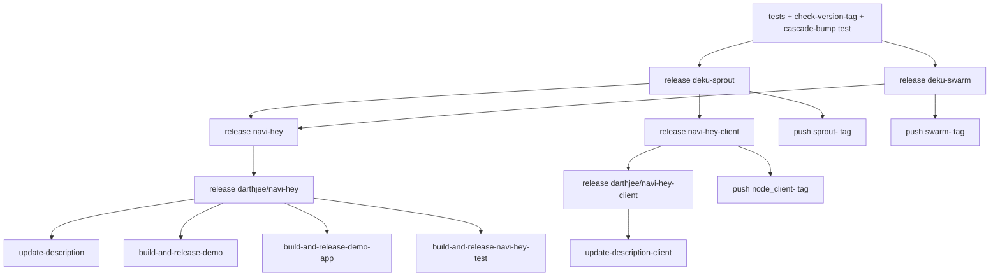

# CI Flow

[Back to the release spec](../release.md)

## Rules

- On an `X.Y.Z` tag, every release job always runs. Each job waits for the jobs of its dependencies, whether those released or no-oped.
- Every release job also waits for the tests (and the tag/version check), which gate the whole release.
- A release job releases its package when [detection](detection.md) says its version is new, and no-ops otherwise.
- After a package with an extra tag released, a separate job pushes that tag (`sprout-`, `swarm-`, `node_client-`; see [Tags](tags.md#extra-tags)).
- The extra jobs follow their image:
  - `update-description`, `build-and-release-demo`, `build-and-release-demo-app` and `build-and-release-navi-hey-test` act only when `darthjee/navi-hey` released.
  - `update-description-client` acts only when `darthjee/navi-hey-client` released.
  - They still run otherwise, as no-ops.
- On PR branches only the tests and the cascade-bump test run.
- On any other tag, nothing runs.

## Job graph

`release navi-hey-client` does not wait for `release deku-swarm`, since the client does not depend on it.
